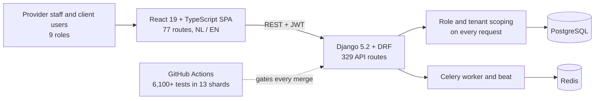

# Göktuğ Yıldırım

Final-year AI student at VU Amsterdam who builds and delivers client software. Two research preprints and the AI projects below are public; the client platform I built is private and documented in a public case study.

Final-year BSc Artificial Intelligence student at Vrije Universiteit Amsterdam. I work on LLM systems, agents and reinforcement learning, and I build client software with AI coding agents: scoped tasks, security rules bound to tests, and independent verification before anything merges.

Open to internships in the Netherlands in 2027: AI engineering, software engineering or full-stack web development, and a bachelor thesis internship.

## Research

| Preprint | Authors | Links |
|---|---|---|
| **When and How Flocks Break: Field of View and Density in the Vicsek Model** (Aug 2026) | B. Kaban, G. Yıldırım, M. Gundogan, D. Popusoi | [doi:10.20944/preprints202608.1003.v1](https://doi.org/10.20944/preprints202608.1003.v1) · [code](https://github.com/yildirimgoktug/vicsek-flocking-field-of-view) |
| **Impact of Feature Preprocessing on Classical Machine Learning Models for Phishing URL Detection** (Jun 2026) | B. Kaban, G. Yıldırım, M. Arslan | [doi:10.20944/preprints202606.1345.v1](https://doi.org/10.20944/preprints202606.1345.v1) · [code](https://github.com/yildirimgoktug/phishing-url-preprocessing-study) |

Both are preprints on Preprints.org and are not peer-reviewed. Full list on [ResearchGate](https://www.researchgate.net/profile/Goktug-Yildirim).

## AI projects

| Project | What it is | Result |
|---|---|---|
| [cartpole-dqn-generalist](https://github.com/yildirimgoktug/cartpole-dqn-generalist) | One DQN agent for CartPole pole lengths 0.4 to 1.8, five training strategies, 25 seeded runs | Reward shaping: mean test score 1,877 → 10,761 |
| [popcorn-rag-movie-search](https://github.com/yildirimgoktug/popcorn-rag-movie-search) | Fully local RAG movie search over 10,800+ films: LlamaIndex, pgvector, Ollama (team of 4) | [Reranking experiment](https://github.com/yildirimgoktug/popcorn-rag-movie-search/tree/goktug/rerank-experiment/experiments/rerank): top-1 retrieval 36% → 80% |
| [cooker-ai-recipe-voice-agent](https://github.com/yildirimgoktug/cooker-ai-recipe-voice-agent) | Spoken recipe recommender: Whisper, BERT intent/slot model, MARBEL dialogue manager, Prolog (team of 5) | 89.3% intent accuracy |
| [voice-accessible-restaurant-ordering](https://github.com/yildirimgoktug/voice-accessible-restaurant-ordering) | Voice-only ordering on a Furhat robot, with a user study (team of 3) | SUS 82.5 vs 67.5, p = 0.03 |
| [schnapsen-ml-agents](https://github.com/yildirimgoktug/schnapsen-ml-agents) | Neural network vs logistic regression agents for the card game Schnapsen (team of 2) | 36% → 64.5% win rate with 10× more training games |
| [cleanops-assistant](https://github.com/yildirimgoktug/cleanops-assistant) | Role-aware assistant for CleanOps: a small Qwen model fine-tuned with LoRA that acts through the platform's own API | Task success 28% → 90% on 120 synthetic test tasks (86% on 179 further unseen tasks); 96 of 99 prompt-injection attacks stopped. Not production-ready; limits in the README |
| [job-alert-copilot](https://github.com/yildirimgoktug/job-alert-copilot) | Reads your own verified LinkedIn job-alert mails, checks fit with explicit rules and prepares a tailored one-page CV from a fact bank; the human presses apply | Early alpha, 185 tests, CI on Linux |
| [nlp-ner-sentiment-topic-analysis](https://github.com/yildirimgoktug/nlp-ner-sentiment-topic-analysis) | Sentiment, named-entity recognition and topic classification on airline tweets (team of 4) | |
| [ufc-knowledge-graph](https://github.com/yildirimgoktug/ufc-knowledge-graph) | Ontology, RDF integration and SPARQL over a UFC knowledge graph (team of 3) | |

## Client software

### CleanOps (source private, [case study public](https://github.com/yildirimgoktug/cleanops-case-study))

A multi-tenant operations, invoicing and client-portal platform for a Dutch facility-services firm: tickets, recurring work, extra-work quotes, contracts, staff hours and invoices, with a portal where each client sees only its own organisation and buildings. I built it on my own with parallel Claude Code agents. It runs on the client's acceptance environment. The source is private; the [case study](https://github.com/yildirimgoktug/cleanops-case-study) documents the architecture, access-control model, invoicing, testing and CI.

- **Security:** probing 194 read endpoints as 9 roles found zero tenant leaks and zero server errors; role-scoped state machines allowed 0 illegal moves in 354 adversarial attempts.
- **Testing and CI:** 6,100+ backend tests. The suite went from a 5.9-hour serial run to about 15 minutes across 13 parallel shards, with a checker that fails the build if any test module is left out of the shard plan.
- **How it was built:** parallel Claude Code agents in isolated git worktrees, each with a scoped task, hard security invariants bound to tests, and independent verification of every branch before merge. The method is published as [agent-ops](https://github.com/yildirimgoktug/agent-ops): templates, worktree scripts and the CI shard-plan checker.

### Client and studio websites

| Site | What it is | Stack |
|---|---|---|
| [bouwly.nl](https://bouwly.nl) | Bouwly Web Studio, the studio I do freelance web work under. One-page NL/EN site | Next.js 14 |
| [kubusklus.nl](https://kubusklus.nl) · [code](https://github.com/yildirimgoktug/kubusklus-website) | Bilingual site for an Amsterdam renovation firm, designed, built and launched by me. Quote form with server-side validation, rate limiting and bot protection | Next.js, TypeScript, Resend, Vercel |
| [OSION Bouwtechniek](https://osion-website.vercel.app/en) (preview, in progress) | Bilingual NL/EN site for a construction-technology firm. It has a login-protected admin panel where the client replaces site photos, manages portfolio projects with before/after pairs, reads and answers quote requests, and sees cookie-free visitor statistics | Next.js 16, TypeScript, Upstash Redis, Vercel Blob, Resend |

## What I work with

**AI and ML** PyTorch, Hugging Face Transformers, scikit-learn, pandas, NumPy, deep RL (DQN, Q-learning), statistical testing

**LLM engineering** RAG (LlamaIndex, pgvector, cross-encoder reranking), retrieval evaluation (top-k accuracy, MRR), Ollama, Whisper, Claude Code multi-agent workflows, prompt and context engineering

**Agents and symbolic AI** BDI agents (MARBEL), Prolog, knowledge graphs (RDF, SPARQL), ROS 2, Furhat

**Software** Python, TypeScript, SQL · Django / DRF, Flask, React, Next.js · PostgreSQL, Redis, Celery · Docker, GitHub Actions, pytest, Playwright

## Spoken languages

Turkish (native), English (fluent)

## Elsewhere

Amsterdam. [bouwly.nl](https://bouwly.nl) · [LinkedIn](https://www.linkedin.com/in/goktugyildirim1) · [ResearchGate](https://www.researchgate.net/profile/Goktug-Yildirim) · goktugyildirim65@gmail.com
